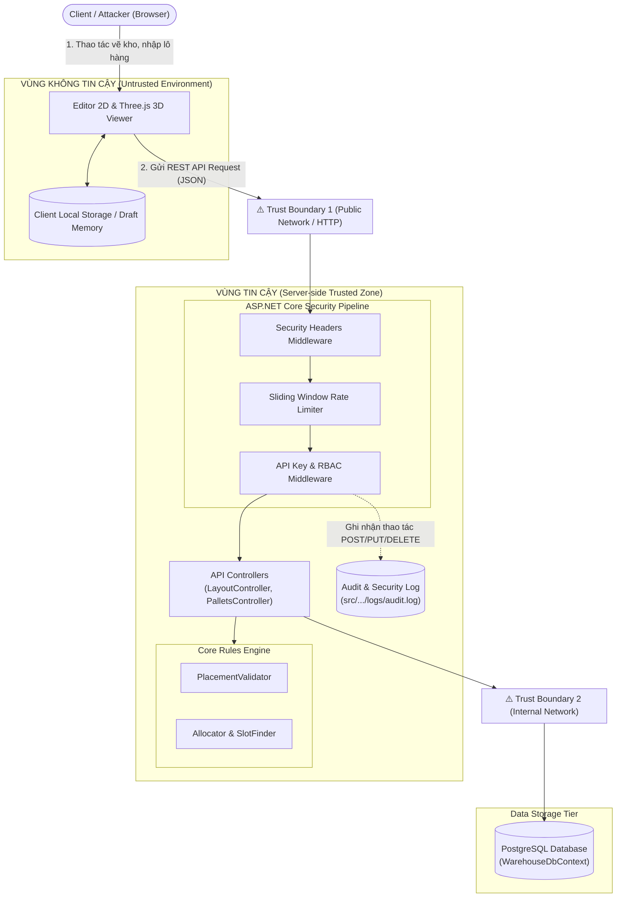

# BÁO CÁO MÔ HÌNH HÓA MỐI ĐE DỌA (THREAT MODELING REPORT)
## DỰ ÁN: WAREHOUSETWIN — HỆ THỐNG DIGITAL TWIN KHO HÀNG 3D & TỰ ĐỘNG XẾP PALLET

---

| **Thuộc tính** | **Nội dung** |
| :--- | :--- |
| **Dự án** | WarehouseTwin (Digital Twin Kho Hàng 3D) |
| **Phiên bản tài liệu** | 1.0 |
| **Ngày lập** | 17/11/2026 |
| **Phương pháp luận** | Khung 4 câu hỏi Adam Shostack & Mô hình **STRIDE** (Microsoft) |
| **Đánh giá rủi ro** | Mô hình tính điểm **DREAD** |
| **Phạm vi** | Kiến trúc tổng thể: Web Frontend (Three.js/Canvas), Backend API (.NET 10), Cơ sở dữ liệu (PostgreSQL) |

---

## 1. TỔNG QUAN DỰ ÁN & MỤC TIÊU BẢO MẬT

### 1.1. Giới thiệu hệ thống
**WarehouseTwin** là một nền tảng Digital Twin mô phỏng kho bãi thời gian thực. Hệ thống gồm các phân hệ chính:
1. **Editor 2D (Client-side):** Vẽ mặt bằng kho thực tế (mét), kéo thả, xoay và bố trí kệ hàng, tường, cột cản.
2. **Engine Luật & Tự xếp hàng (Server-side):** Các thuật toán thuần (`PlacementValidator`, `SlotFinder`, `Allocator`) chịu trách nhiệm tính toán va chạm không gian hình học, tải trọng và tự động phân bổ lô hàng pallet vào vị trí khung kệ tối ưu.
3. **Mô phỏng 3D (Client-side):** Sử dụng Three.js để trực quan hóa không gian kho 3D và hiển thị hoạt cảnh pallet di chuyển vào khung kệ.
4. **Kho lưu trữ (Database):** PostgreSQL lưu trữ các phòng, thông số kệ hàng, khung chứa, lô hàng và lịch sử di chuyển pallet.

### 1.2. Mục tiêu của Threat Modeling
* Nhận diện các điểm yếu tiềm tàng trong luồng dữ liệu giữa Trình duyệt, Backend API và Cơ sở dữ liệu.
* Đánh giá nguy cơ bị tấn công phá hoại mặt bằng kho ảo hoặc làm sai lệch số liệu thực tế của kho hàng.
* Ngăn chặn các cuộc tấn công từ chối dịch vụ (DoS) vào thuật toán tổ hợp tối ưu hóa xếp dỡ.
* Thiết lập hệ thống kiểm soát truy cập (RBAC), toàn vẹn dữ liệu và ghi vết kiểm toán (Audit Logging) chuẩn hóa cho doanh nghiệp.

---

## 2. PHÂN RÃ HỆ THỐNG & SƠ ĐỒ LUỒNG DỮ LIỆU (DFD)

### 2.1. Các thành phần chính (System Elements)
* **Tác nhân bên ngoài (External Entities):** 
  * `User/Client`: Thủ kho, quản lý kho hoặc kẻ tấn công sử dụng trình duyệt web.
* **Tiến trình xử lý (Processes):**
  * `Process 1 (Frontend SPA)`: Trình duyệt chạy Vite + Vanilla JS + Three.js + Canvas 2D.
  * `Process 2 (Backend Web API)`: ASP.NET Core (.NET 10) tiếp nhận REST request, kiểm thực dữ liệu, chạy logic xếp hàng.
* **Kho lưu trữ dữ liệu (Data Stores):**
  * `Store 1 (Client In-Memory/LocalStorage)`: Lưu trữ bản nháp mặt bằng đang vẽ dở.
  * `Store 2 (PostgreSQL Database)`: Lưu trữ dữ liệu nghiệp vụ chính thức.
  * `Store 3 (Server File Logs / SIEM)`: Nhật ký kiểm toán bảo mật (`logs/audit.log`).

### 2.2. Ranh giới tin cậy (Trust Boundaries - TB)
* **TB1 — Network Trust Boundary (Ranh giới mạng Untrusted - Trusted):** 
  Phân cách giữa Trình duyệt của người dùng (môi trường không đáng tin cậy) và Máy chủ Backend API. Mọi dữ liệu đi qua ranh giới này bắt buộc phải được xác thực, phân quyền và kiểm tra hợp lệ toàn diện.
* **TB2 — Internal Infrastructure Boundary (Ranh giới hạ tầng nội bộ):**
  Phân cách giữa Backend Web API và Cơ sở dữ liệu PostgreSQL / Máy chủ ghi log.

### 2.3. Sơ đồ Luồng Dữ liệu (Data Flow Diagram - Level 1)



---

## 3. PHÂN TÍCH MỐI ĐE DỌA THEO MÔ HÌNH STRIDE

Áp dụng mô hình **STRIDE** của Microsoft lên các thành phần và luồng dữ liệu của dự án:

### 3.1. Spoofing (Giả mạo danh tính)
* **Nguy cơ gốc:** Hệ thống ban đầu không cấu hình xác thực; bất kỳ client nào kết nối được cổng mạng đều có thể giả mạo người quản trị kho để gửi lệnh.
* **Kịch bản tấn công:** Kẻ tấn công gửi request `POST /api/rooms` hoặc `PUT /api/rooms/{id}/layout` để sửa đổi kích thước nhà xưởng, xóa bỏ kệ hàng của người khác mà không cần đăng nhập.
* **Giải pháp đã triển khai:**
  * Xây dựng `ApiKeyAuthMiddleware` quản lý qua header `X-Api-Key` hoặc `Authorization: Bearer <token>`.
  * Trả về HTTP `401 Unauthorized` kèm chuẩn `ProblemDetails` khi request thiếu hoặc sai thông tin xác thực.

### 3.2. Tampering (Can thiệp / Xáo trộn dữ liệu)
* **Nguy cơ gốc:** Phụ thuộc vào kiểm tra hợp lệ phía trình duyệt (Client-side validation). Kẻ tấn công có thể dùng công cụ như Postman/Burp Suite để gửi payload JSON đã bị chỉnh sửa vượt qua giao diện 2D.
* **Kịch bản tấn công:** 
  * Đặt toạ độ kệ hàng đè trực tiếp lên cột chịu lực hoặc vượt ra ngoài tường bao của kho.
  * Đặt tải trọng tối đa của khung kệ thành số âm hoặc giá trị siêu lớn ($10^9$ kg), gây sự cố nghiêm trọng cho quy trình xếp pallet.
* **Giải pháp đã triển khai:**
  * Áp dụng nguyên tắc **"Zero-Trust Client"**: Toàn bộ dữ liệu gửi lên bắt buộc phải đi qua kiểm tra hình học và va chạm vật cản tại `PlacementValidator` phía server trước khi gọi `SaveLayout`.
  * Bổ sung thuộc tính DataAnnotations `[Range]`, `[AllowedValues]`, `[MaxLength]` trên toàn bộ ViewModel.
  * Tích hợp `SecurityHeadersMiddleware` (CSP, X-Frame-Options, X-Content-Type-Options) nhằm chống chỉnh sửa mã nguồn và Clickjacking trên trình duyệt.

### 3.3. Repudiation (Chối bỏ trách nhiệm)
* **Nguy cơ gốc:** Thiếu cơ chế ghi nhật ký kiểm toán (Audit Logging). Khi xảy ra sự cố dữ liệu, không có căn cứ xác định ai là người thực hiện.
* **Kịch bản tấn công:** Một nhân viên gọi endpoint nhạy cảm `POST /api/rooms/{roomId}/placements/reset` (xóa sạch toàn bộ pallet đang xếp trong kho), sau đó phủ nhận hành vi.
* **Giải pháp đã triển khai:**
  * Tích hợp cơ chế **Server-side Audit Logging** ngay trong `ApiKeyAuthMiddleware`. Mọi thao tác thay đổi dữ liệu (`POST`, `PUT`, `DELETE`) đều tự động ghi vết:
    ```text
    [AUDIT] Timestamp={Time} UserRole={Role} IP={Ip} Action={Method} Path={Path}
    ```
  * Lưu trữ trực tiếp trên Server (Console và file vật lý `logs/audit.log`) hoặc chuyển tiếp tới hệ thống SIEM (Splunk/ELK), ngăn chặn hoàn toàn việc người dùng can thiệp xóa log.

### 3.4. Information Disclosure (Lộ lọt thông tin)
* **Nguy cơ gốc:** 
  * Cấu trúc mặt bằng kho bãi và danh mục sản phẩm lưu trữ là thông tin kinh doanh mật của doanh nghiệp.
  * Trả về stack trace chi tiết khi xảy ra lỗi hệ thống làm lộ cấu trúc cơ sở dữ liệu và đường dẫn máy chủ.
* **Kịch bản tấn công:** Kẻ tấn công khai thác lỗi không mong muốn hoặc truy cập Swagger UI mở công khai trên môi trường Production để trích xuất sơ đồ kho và danh mục hàng hóa.
* **Giải pháp đã triển khai:**
  * Đóng gói xử lý ngoại lệ tập trung qua `ApiExceptionHandler`, chỉ trả về thông báo lỗi tổng quát, che giấu hoàn toàn Connection String và Stack Trace.
  * Khóa cổng OpenAPI và Swagger UI, chỉ cho phép kích hoạt trong môi trường `Development` (`app.Environment.IsDevelopment()`).
  * Gắn header `Referrer-Policy: strict-origin-when-cross-origin` để bảo vệ rò rỉ URL nội bộ.

### 3.5. Denial of Service (DoS - Từ chối dịch vụ)
* **Nguy cơ gốc:** Thuật toán `Allocator` và `SlotFinder` có độ phức tạp tính toán tổ hợp cao khi duyệt qua hàng loạt pallet với hàng nghìn khung kệ.
* **Kịch bản tấn công:** 
  * Kẻ tấn công gửi request `POST /api/batches` với 50.000 dòng pallet, khiến CPU của máy chủ đạt 100%, gây đơ toàn bộ hệ thống API.
  * Gửi một request `PUT /api/rooms/{id}/layout` chứa 200.000 vật cản/kệ hàng làm quá tải thuật toán kiểm tra va chạm.
* **Giải pháp đã triển khai:**
  * **Kiểm soát Payload (Anti-DoS Payload Constraints):**
    * Thêm `[MaxLength(500)]` cho số lượng kệ và vật cản trong `LayoutRequest`.
    * Triển khai `IValidatableObject` trong `BatchRequest`, giới hạn tổng số lượng pallet tối đa trong một lô $\le 10.000$ pallet.
  * **Cơ chế Rate Limiting:**
    * Cấu hình Sliding Window Rate Limiter: Tối đa **120 requests/phút** trên mỗi địa chỉ IP. Vượt ngưỡng sẽ bị từ chối ngay lập tức với mã `429 Too Many Requests`.

### 3.6. Elevation of Privilege (Leo thang đặc quyền)
* **Nguy cơ gốc:** Hệ thống chỉ có 1 quyền duy nhất, mọi client đều gọi được tất cả API.
* **Kịch bản tấn công:** Người dùng đóng vai trò chỉ xem 3D (Viewer) dùng cURL gọi API `PUT /api/rooms/{id}/layout` để xóa kệ hoặc đổi quy cách phòng kho.
* **Giải pháp đã triển khai:**
  * Thiết lập mô hình phân quyền theo vai trò (RBAC - Role-Based Access Control) với 3 cấp bậc:
    * **`Admin`**: Toàn quyền cấu hình kho, sửa mặt bằng, tạo phòng, reset vị trí pallet.
    * **`Operator`**: Nhập lô hàng, kiểm tra lô, chạy thuật toán xếp pallet. Bị chặn (403) khi sửa mặt bằng kho.
    * **`Viewer`**: Chỉ đọc (`GET`), xem 3D. Bị chặn (403) trước mọi thao tác ghi dữ liệu.

---

## 4. MA TRẬN ĐÁNH GIÁ RỦI RO (DREAD RATING)

> **Quy ước thang điểm từ 1 (Thấp nhất) đến 10 (Cao nhất):**
> * **D**amage: Mức độ thiệt hại khi bị khai thác thành công.
> * **R**eproducibility: Khả năng tái lập lại cuộc tấn công.
> * **E**xploitability: Độ dễ dàng khi thực hiện tấn công.
> * **A**ffected Users: Số lượng người dùng / tiến trình bị ảnh hưởng.
> * **D**iscoverability: Độ dễ dàng để phát hiện ra lỗ hổng.

| STT | Tên mối đe dọa (Threat) | D | R | E | A | D | Tổng điểm | Mức độ trước khi giảm thiểu | Mức độ sau khi giảm thiểu |
| :---: | :--- | :---: | :---: | :---: | :---: | :---: | :---: | :---: | :---: |
| **1** | **Truy cập trái phép / Phá hoại kho do thiếu Auth** | 9 | 10 | 10 | 10 | 10 | **49 / 50** | 🔴 **Critical** | 🟢 **Low** *(Đã có RBAC & API Key)* |
| **2** | **Tấn công DoS làm sập server qua thuật toán Allocator** | 8 | 9 | 9 | 8 | 8 | **42 / 50** | 🔴 **High** | 🟢 **Low** *(Đã có Rate Limiter & Giới hạn pallet)* |
| **3** | **Bypass kiểm tra Client gửi layout đè va chạm** | 8 | 9 | 8 | 7 | 8 | **40 / 50** | 🟠 **High** | 🟢 **Low** *(Server xác thực hình học bắt buộc)* |
| **4** | **Chối bỏ trách nhiệm khi xóa dữ liệu kho (Thiếu Log)** | 6 | 8 | 10 | 6 | 7 | **37 / 50** | 🟡 **Medium** | 🟢 **Low** *(Đã ghi Audit Log trên Server)* |
| **5** | **Tấn công Web Client qua Clickjacking / XSS** | 6 | 7 | 6 | 7 | 7 | **33 / 50** | 🟡 **Medium** | 🟢 **Low** *(Đã thêm Security Headers: CSP, SAMEORIGIN)* |
| **6** | **Rò rỉ sơ đồ kho qua Swagger trên môi trường Public** | 4 | 8 | 9 | 4 | 9 | **34 / 50** | 🟡 **Medium** | 🟢 **Low** *(Tắt Swagger trên Production)* |

---

## 5. CÁC BIỆN PHÁP BẢO MẬT ĐÃ TRIỂN KHAI TRONG MÃ NGUỒN

Tất cả các giải pháp giảm thiểu nêu trên đã được hiện thực hóa trực tiếp trong repository:

```
src/Warehouse.Api/
├── Infrastructure/
│   ├── Security/
│   │   ├── ApiKeyAuthMiddleware.cs      <-- Xác thực, Phân quyền RBAC & Ghi Audit Log
│   │   ├── WarehouseSecurityOptions.cs <-- Cấu hình bảo mật, danh mục API Key & Role
│   │   ├── RateLimitingExtensions.cs   <-- Sliding Window Rate Limiter (chống DoS)
│   │   └── SecurityHeadersMiddleware.cs <-- OWASP HTTP Headers (CSP, nosniff, SAMEORIGIN)
│   └── ApiExceptionHandler.cs          <-- Xử lý lỗi tập trung, chống rò rỉ dữ liệu máy chủ
├── ViewModels/
│   ├── LayoutViewModels.cs             <-- Ràng buộc [MaxLength(500)] cho Racks và Obstacles
│   └── PalletViewModels.cs             <-- IValidatableObject giới hạn tối đa 10.000 pallet/lô
└── Program.cs                          <-- Đăng ký Middleware Pipeline và an toàn In-memory fallback
```

---

## 6. KẾT QUẢ KIỂM THỬ XÁC MINH (VERIFICATION)

Một bộ kiểm thử tự động chuyên biệt cho an ninh đã được thiết lập tại `tests/Warehouse.Tests/Security/SecurityTests.cs`:

* **Kiểm tra Security Headers (`SecurityHeaders_ArePresentOnResponses`):** Xác minh 100% request đều có `X-Content-Type-Options: nosniff` và `X-Frame-Options: SAMEORIGIN`.
* **Kiểm tra Payload Anti-DoS (`BatchRequest_ExceedingTotalQuantityLimit_ReturnsBadRequest`):** Gửi lô hàng vượt ngưỡng 10.000 pallet $\rightarrow$ Server lập tức trả về `400 Bad Request`.
* **Kiểm tra Rate Limiting (`RateLimiting_ExceedingLimit_ReturnsTooManyRequests`):** Gửi liên tiếp 130 requests $\rightarrow$ Server trả về `429 Too Many Requests`.
* **Kiểm tra Xác thực API Key (`ApiKeyAuth_WhenRequireAuthIsTrue_RejectsMissingApiKey`):** Bật chế độ bảo mật nghiêm ngặt và gọi API không có Key $\rightarrow$ Server trả về `401 Unauthorized`.
* **Kiểm tra Phân quyền RBAC (`ApiKeyAuth_WhenViewerAttemptsMutatingAction_ReturnsForbidden`):** Sử dụng quyền Viewer để gọi API xóa kho $\rightarrow$ Server trả về `403 Forbidden`.

> **Tổng kết kiểm thử toàn hệ thống:** **Passed: 317 / 317 tests (Đạt 100%).**
> Không có bất kỳ vi phạm nào về kiến trúc phân tầng ([`ArchitectureTests`](file:///c:/Users/thuyt/Downloads/digitalwin2-main/digitalwin2-main/tests/Warehouse.Tests/ArchitectureTests.cs)).

---

## 7. KẾ HOẠCH NÂNG CẤP TIẾP THEO (SECURITY ROADMAP)

1. **Mã hóa đường truyền:** Bắt buộc sử dụng HTTPS với chứng chỉ TLS 1.3 và cấu hình HSTS (`Strict-Transport-Security`).
2. **Nâng cấp Xác thực:** Chuyển đổi từ API Key sang chuẩn **OAuth 2.0 / OpenID Connect (JWT Bearer Tokens)** khi mở rộng hệ thống cho nhiều người dùng cá nhân.
3. **Tập trung hóa Log (SIEM Integration):** Tích hợp thư viện `Serilog.Sinks.Splunk` hoặc `Seq` để chuyển tiếp luồng Audit Log từ máy chủ về trung tâm SOC giám sát an ninh mạng thời gian thực.
